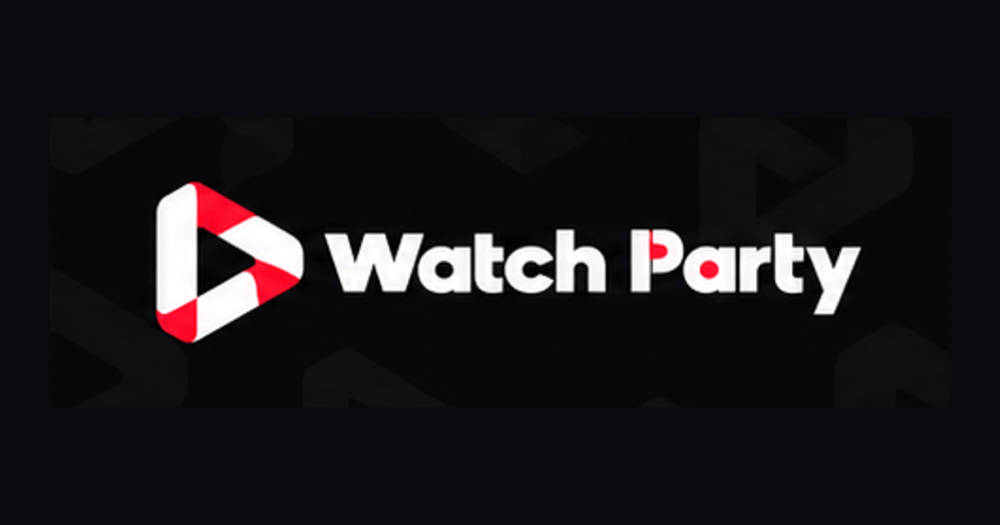
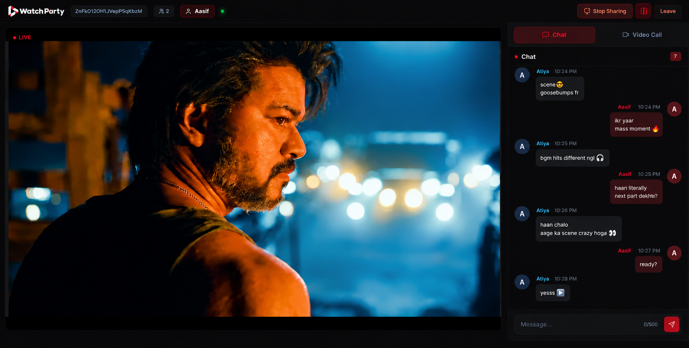

<div align="center">

  

  # WatchParty
  ### 🎬 Watch Movies, Shows &amp; YouTube Together in True Frame-Locked Sync

  [](https://watchparty.website/)
  [](LICENSE)
  [](https://react.dev/)
  [](https://socket.io/)
  [](https://webrtc.org/)

  <p align="center">
    <b>WatchParty</b> is a modern, zero-install virtual cinema and synchronized video streaming platform that lets friends, couples, and communities watch movies, OTT streams, anime, and YouTube together with sub-second sync, live sidecar chat, and crystal-clear video calls.
  </p>

  **[🌐 Visit Live Website](https://watchparty.website/)** • **[Report Bug](https://github.com/aasif-md1/watch-party-app/issues)** • **[Request Feature](https://github.com/aasif-md1/watch-party-app/issues)**

</div>

---

## 📸 The Live Cinema Experience

<div align="center">
  
  <p><i>Live screening room showing synchronized 1080p playback on the left with live sidecar banter on the right.</i></p>
</div>

---

## ✨ Features

- **⚡ Sub-Second Frame-Locked Sync**:
  Host play, pause ya seek kare — room me sabhi viewers exact millisecond frame par synchronized rehte hain. Periodic heartbeat drift monitor keeps streams aligned within 1.5 seconds.
- **🖥️ 1080p 60fps Screen Sharing**:
  Share your entire desktop, a window, or a specific browser tab with system audio. Stream Netflix, Crunchyroll, Disney+, Prime Video, or local video files in crisp HD.
- **💬 Live Sidecar Chat & Banter**:
  Instant messaging alongside the screen that never obstructs your movie view. Messages are sanitized with DOMPurify for XSS protection, with live emoji reactions and sound toggles.
- **🎙️ WebRTC Video & Voice Calling with Noise Gate**:
  Peer-to-peer camera and microphone feeds. Audio passes through a custom Web Audio API processing chain (noise gate, highpass filter, compressor) filtering keyboard clicks and ambient noise.
- **🎭 Real-Time Video Filters & Stickers**:
  Apply neon, sepia, B&W, and vintage filters or drag interactive emoji stickers onto video feeds, synced live across all participants.
- **🔐 Google Firebase Authentication**:
  Quick, secure login with Google for personal profiles, custom room handles, and persistent room states.
- **📱 Responsive Mobile & OLED Cinema Design**:
  Optimized layouts for mobile phones, tablets, and desktop displays with eye-pleasing ambient red backlighting.
- **🌐 English & Hinglish Toggle**:
  Seamless one-click language toggle across the entire homepage.

---

## 🛠️ Tech Stack

| Technology | Purpose |
|------------|---------|
| **React 18 + Vite** | Fast modern frontend framework & build system |
| **Node.js + Express** | High-performance backend API server |
| **Socket.IO** | Sub-second real-time state synchronization & messaging |
| **WebRTC** | Peer-to-peer audio, video, and screen streaming |
| **Firebase Auth** | Google OAuth authentication & session tokens |
| **Web Audio API** | Dynamic noise gate, audio filters, and voice processing |
| **DOMPurify** | Robust chat message sanitization (XSS mitigation) |
| **Tailwind CSS + Custom CSS** | Obsidian-dark theater design system & Ambilight effects |
| **nanoid** | Cryptographically secure room ID generation |

---

## 🚀 Getting Started Locally

### Prerequisites
- [Node.js](https://nodejs.org/) (v18 or higher recommended)
- `npm` or `yarn`

### 1. Clone the repository
```bash
git clone https://github.com/aasif-md1/watch-party-app.git
cd watch-party-app
```

### 2. Setup the Server
```bash
cd server
npm install
npm run dev
```
The backend server runs on `http://localhost:5000`.

### 3. Setup the Client
Open a second terminal window:
```bash
cd client
npm install
npm run dev
```
The frontend application will start on `http://localhost:5173`.

---

## ⚙️ Environment Variables

### Client (`client/.env`)
```env
VITE_SERVER_URL=http://localhost:5000
VITE_FIREBASE_API_KEY=your_firebase_api_key
VITE_FIREBASE_AUTH_DOMAIN=your_project.firebaseapp.com
VITE_FIREBASE_PROJECT_ID=your_project_id
VITE_FIREBASE_STORAGE_BUCKET=your_project.appspot.com
VITE_FIREBASE_MESSAGING_SENDER_ID=your_sender_id
VITE_FIREBASE_APP_ID=your_app_id
```

### Server (`server/.env`)
```env
PORT=5000
CLIENT_URL=http://localhost:5173
```

---

## 📄 License

Distributed under the **MIT License**. See [`LICENSE`](LICENSE) for full details.

---

## 👤 Author

**Md Aasif**
- Website: [watchparty.website](https://watchparty.website/)
- GitHub: [@aasif-md1](https://github.com/aasif-md1)
- Email: [mdaasif18092003@gmail.com](mailto:mdaasif18092003@gmail.com)

---

<div align="center">
  <sub>Built with ❤️ for shared movie nights everywhere.</sub>
</div>
